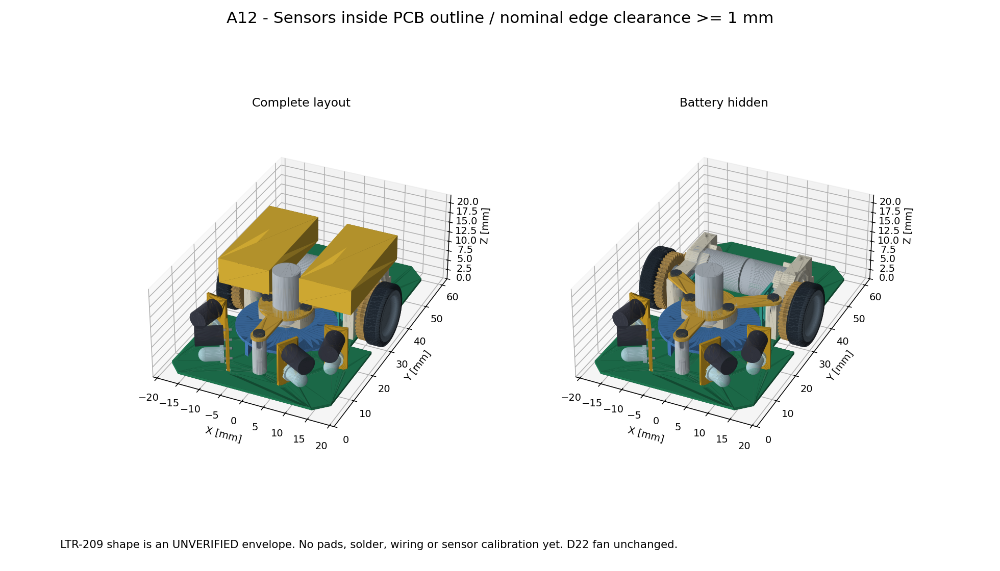

# NEW_HALF_Micromouse

ハーフサイズ・マイクロマウスの新機体。

- 部品・回路は [ToraNeko.Mk3](https://github.com/Tokoro0917/ToraNeko.Mk3) を参考にする。
- 基板形状は新規設計、ソフトウェアは自作する。
- 浜砂さんの type6 を寸法・配置の参考にし、全長66 × 全幅39 × 高さ22 mm、23 gを目標にする。
- 車軸は前後中央（前端から33 mm）。電池など重い部品を中央寄りに配置する。完成機の重心は部品質量を測って確認する。

寸法の軸順は現時点の解釈。寸法・重量は完成機の目標であり、達成を確認した値ではない。

## 設計資料

- [A12 センサを基板外形の内側へ（最新）](docs/outline-a12.md)：前側外形を拡張し、センサ全体との名目隙間1 mm以上を確認。[上面図](mechanical/sensor-a12-top.png) / [3Dビューア](mechanical/assembly-a12.html) / [STEP](mechanical/assembly-a12.step)

- [A11 吸引部を3点支持へ](docs/three-point-a11.md)：前側中央支柱1点＋左右駆動マウント2点。[3Dビューア](mechanical/assembly-a11.html) / [STEP](mechanical/assembly-a11.step)

- [A10 センサ用途・角度の修正](docs/sensor-a10.md)：タイヤ寄りが前壁用±10°、機体前方が横壁用±60°。[3Dビューア](mechanical/assembly-a10.html) / [STEP](mechanical/assembly-a10.step)

- [A09 センサ角度](docs/sensor-a09.md)：真正面0°、前壁用±10°・横壁用±30°。[3Dビューア](mechanical/assembly-a09.html) / [STEP](mechanical/assembly-a09.step)

- [A08 センサ立て基板](docs/sensor-a08.md)：ToraNekoと同じ発光・受光を上下2段、4組配置。LTR-209外形は未確認の予約形状。[3Dビューア](mechanical/assembly-a08.html) / [STEP](mechanical/assembly-a08.step)

- [A07 ファンを車軸寄りへ](docs/fan-mount-a07.md)：ファン中心Y=21.75、電池を左右へ各3.2 mm移動。[3Dビューア](mechanical/assembly-a07.html) / [STEP](mechanical/assembly-a07.step)

- [A06 ToraNeko方式のファン固定](docs/fan-mount-a06.md)：元の上部固定基板・前側支柱・駆動マウントを使う構成。[3Dビューア](mechanical/assembly-a06.html) / [STEP](mechanical/assembly-a06.step)

- [A05 ファン固定案](docs/fan-mount-a05.md)：左右支柱と上側の橋渡し板。[3Dビューア](mechanical/assembly-a05.html) / [STEP](mechanical/assembly-a05.step)。Φ22羽根用・ねじ仕様未確定

- [A04 組立3Dモデル](docs/assembly-a04.md)：[回転できるHTML](mechanical/assembly-a04.html) / [STEP](mechanical/assembly-a04.step) / [GLB](mechanical/assembly-a04.glb)
- [各5 gとした重心概算](docs/center-of-gravity-5g.md)：主要5グループのみで車軸の約1.7 mm前、床から約11.3 mm。実測・完成機全体の値ではない
- [A04重心調査](docs/center-of-gravity-a04.md)：元CADの密度設定に問題があるため、実機の重心は未確定。部品位置・監査結果・質量入力後の計算方法
- [配置検討 A04（最新）](docs/layout-a04.md)：車軸・電池を中央へ移動し、吸引部を含む460組の静的チェックを実施。重心位置は未測定
- [A04配置図](mechanical/layout-a04.png)・[基板候補STEP](mechanical/pcb-a04-concept.step)・[質量記入表](mechanical/mass-input.csv)
- [配置検討 A03](docs/layout-a03.md)：取付穴付き基板と192組の静的干渉確認。製造用の確定設計ではない
- [基板候補STEP](mechanical/pcb-a03-concept.step)・[上面／3D図](mechanical/pcb-a03-preview.png)
- [配置検討 A02](docs/layout-a02.md)：STEP測定による駆動部幅38.8 mmの案。外幅余裕・モータ端部間隔は要確認
- [A02の上面・側面図](mechanical/layout-a02.png)
- [配置検討 A01](docs/layout-a01.md)：出典、確認済み寸法、仮配置、未解決事項
- [寸法入り配置図](mechanical/layout-a01.svg)：部品の占有範囲を検討する上面図。製造用図面ではない
- [図面生成スクリプト](mechanical/generate_layout.py)：Python標準ライブラリのみ。`python3 mechanical/generate_layout.py` で再生成

