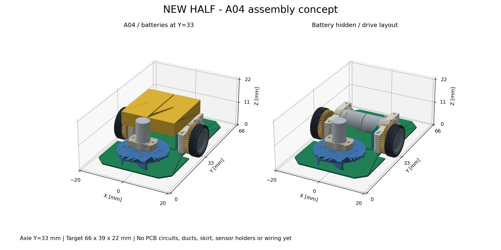

# A04 組立3Dモデル



## 開くファイル

| ファイル | 用途 |
|---|---|
| [3Dビューア HTML](../mechanical/assembly-a04.html) | 回転・拡大、部品の表示切替。ブラウザ用。必要なJavaScriptと形状データを同梱 |
| [STEP](../mechanical/assembly-a04.step) | CADでの配置確認・編集。部品分けと色を保持。座標単位mm |
| [GLB](../mechanical/assembly-a04.glb) | 対応する3Dビューア向け。glTF標準のY上向きに変換して出力 |
| [PNG](../mechanical/assembly-a04.png) | 組立状態／電池非表示の静止プレビュー |
| [構成・検証記録](../mechanical/assembly-a04-manifest.json) | 部品と参照元の対応、外接寸法、STEP読み戻し結果 |

HTMLをブラウザで開くと、ドラッグで回転、ホイールで拡大できる。凡例で各部品群を表示・非表示にできる。
「電池を隠す」は駆動部の確認用。「参照線・重心を隠す」はモデル形状だけを見るためのもの。
ブラウザや閲覧アプリがローカルHTMLを制限する場合は、対応したローカルWebサーバー経由で開くか、GLB/STEPを利用する。

## 反映した配置

- 機体目標：全長66 × 全幅39 × 高さ22 mm。
- 車軸：前端から33 mm。左右タイヤは共通軸上。
- 電池2本：中心Y=33、X=±6.3、Z=16.5 mm。各12×25×6 mmの外形ブロック。
- 電池を約4.3 mm後方へ動かす重心調整案は**適用していない**。
- 駆動モータ・ギア・車輪・マウント・エンコーダをA04の配置で組み立てた。
- 吸引モータ・マウント・羽根はA04のY=16.5へ配置。羽根は元STEPに形状があるΦ22版。文書記載のΦ30へ勝手に拡大していない。
- 新規基板はA04の切欠き・取付穴付き形状。

現モデルの外接寸法は幅38.8 × 長さ56.0 × 高さ約19.887 mm。
Y=5〜61 mmに形状があり、まだ目標前後端Y=0/66まで張り出すスカート等は含まない。
元の設計目標66×39×22 mmを、現モデルの実寸と混同しない。

## 重心マーカー

HTMLの赤いマーカーは、主要5グループをそれぞれ5 gと仮定した[重心概算](center-of-gravity-5g.md)。
座標はX≈0、Y≈31.286、Z≈11.342 mm。
基板・配線等はこの質量計算に含まず、完成機の実測重心ではない。
STEPとGLBにはこのマーカーや目標枠・車軸の参照線を物理部品として混入させていない。

## モデルの範囲と省略

形状がある66部品インスタンス、96ソリッドを収録。
電池は製品内部や配線を再現したものではなく、外形の仮置き。
回路・配線・コネクタ、スカート、吸引ケース・流路、電池ホルダー、センサ支持部・取付部、追加ネジ等は未設計。
吸引部や電池を所定位置へ固定する構造は完成しておらず、空間配置の検討用である。

元STEPの非ミラー側軸受保持器2形状は不正で、CadQueryの修復処理でも有効な形状にならなかった。
内部の保持器だけを左右対称に4個とも表示省略した。軸受の輪・ボールは表示する。
実物から保持器を取り除く提案ではない。省略部品名は構成JSONに保存した。

基板・電池・吸引部の静的干渉確認は[A04記録](layout-a04.md)を参照。
同じ側の駆動部品の元設計の嵌合、回転全域、組立手順、製造公差、強度、実走性能は未検証。
色は表示の識別用で、材質や密度を指定していない。**製造用確定モデルではない。**

## 検証

- 生成に使用した全形状が有効であることを確認。
- CADの正確な境界で目標外形内を確認。表示用三角形メッシュの偏差を外形寸法に含めない。
- STEPを読み戻し、96ソリッドが保持され、形状が有効で外接寸法が一致することを確認。
- GLBヘッダー・JSONチャンクを確認。66メッシュ、67ノード。
- ChromiumのWebGLでHTMLを実際に表示。電池非表示／全表示の切替を確認し、JavaScript例外なし。
- PNGを目視確認。

## 出典・ライセンス

駆動部・吸引部の形状は、[Tokoro0917/ToraNeko.Mk3](https://github.com/Tokoro0917/ToraNeko.Mk3) の
コミット `724d4f428ec6e257e55830514f37e31215f05e83` にある `mechanical/exported/TORANEKO.Mk3_v36.step` を使用。
参照ファイルSHA-256：`e37a94ba0502e935bd09b7f2973f216830a515db4f88e3210957fa27de5b49ad`。

Copyright (c) 2026 Tokoro0917。MIT License。
[著作権・ライセンス本文](../mechanical/third_party/ToraNeko.Mk3.LICENSE)を同梱した。
STEP/GLB/HTML/PNGは参照CADを含む派生出力なので、配布するときはこの表示・ライセンスを添付する。
今回の変更は駆動部・吸引部の配置、新規基板、電池外形の追加、表示用の色付けと内部保持器の省略。
参照ファイル自体を変更していない。

## 再生成

Python 3.12、CadQuery 2.7.0、Matplotlib 3.10.8、Plotly 6.3.1で確認。
参照STEPはチェックアウト外の`/workspace/library-files/TORANEKO.Mk3_v36.step`に取得して使用した。

```sh
python3 -m venv /workspace/.tools/mouse-view
/workspace/.tools/mouse-view/bin/pip install -r mechanical/requirements-assembly.txt
XDG_CACHE_HOME=/tmp/mouse-cad-cache MPLCONFIGDIR=/tmp/mouse-matplotlib /workspace/.tools/mouse-view/bin/python mechanical/build_assembly_a04.py /workspace/library-files/TORANEKO.Mk3_v36.step
```

スクリプトは保存済みの`layout-a04-checks.json`、`pcb-a04-concept.step`、`cg-a04-5g.json`も入力に使う。
配置を変更した場合は、それらの検査・重心資料を更新してから再生成する。
