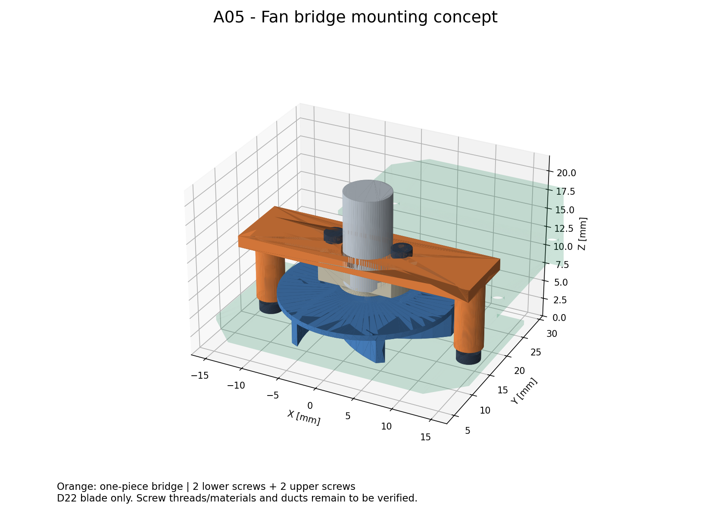

# A05 ファン固定案：左右支柱付きの門型支持具



[組立3Dビューア](../mechanical/assembly-a05.html) / [組立STEP](../mechanical/assembly-a05.step) / [GLB](../mechanical/assembly-a05.glb) / [支持具単体STEP](../mechanical/fan-bridge-a05.step) / [支持具単体STL](../mechanical/fan-bridge-a05.stl) / [穴追加基板STEP](../mechanical/pcb-a05-concept.step)

A04の車軸・電池・ファン位置を維持し、ファンマウントと基板の間に取り外し可能な支持具を追加した候補。
**ねじ規格と強度は未確認であり、製造用の確定設計ではない。** 元のA04ファイルは比較用に保存している。

## 推奨する構成

支持具は、左右の支柱と上側の橋渡し板が一体になった樹脂部品。基板へ下から2本のネジで固定し、上から2本のネジで既存のファンモータマウントを吊る。
橋渡し板の中央穴からモータを通す。荷重は「ファン・モータ → 元のモータマウント → 上側ネジ・支持具 → 左右支柱 → 基板」と伝える。
左右対称で、ファン軸のY=16.5から追加部品の重心が大きく離れない配置とした。

| 項目 | 候補寸法・位置（mm） |
|---|---|
| 支柱中心 | X=±13.5、Y=16.5 |
| 支柱外径 | 3.6 |
| 支柱下面 | Z=2.38693（基板上面に接触） |
| 橋渡し板 | 幅30.6 × 前後9 × 厚さ1.5 |
| 橋渡し板の下面／上面 | Z=10.88693／12.38693 |
| モータ逃げ穴 | Φ6.4、中心X=0、Y=16.5 |
| 上側ネジ位置 | X=±4.5、Y=16.5、支持具通し穴Φ1.6 |
| 基板追加穴 | X=±13.5、Y=16.5、Φ1.7 × 2 |
| 支柱側の仮下穴 | Φ1.3、深さ4（材質・タップ条件で見直す） |

支持具はまず靭性のある樹脂で試作する。PA系を候補とし、形状確認用の造形と最終使用材料を区別する。橋渡し板と支柱の接合部は、工具・羽根との干渉を再確認したうえで隅Rや補強を検討する。現モデルには隅Rを入れていない。

## ネジ仕様を確定する前の確認

元CADのマウント固定穴はX=±4.5、Y=16.5、円筒径約1.221。ねじ山の形状・規格・マウント材料はこの形状から断定できない。
上側は**M1.4×3の占有形状を仮置き**した。橋渡し板1.5 mmに対し、マウントへの掛かりは約1.5 mm。
既存穴をM1.4の下穴として無条件に使用する指示ではない。現物の既存ネジと材料を確認し、合うネジに支持具穴径を合わせる。
必要なら交換マウント側を適切なタップ下穴から加工する。既存穴のまま十分なねじ保持力を得られない場合は、この締結候補は不採用とする。

下側はM1.6×3相当の占有形状を仮置き。基板厚0.6に対して支柱に約2.4 mm入る。支柱側は樹脂へねじ加工する想定だが、繰返し脱着の耐久性は未検証。
モデルの頭は上側Φ2.6×高さ1.0、下側Φ3.0×高さ1.2の仮の円筒。購入品の頭径・高さ・工具形状に置き換えてから最終確認する。
下側ネジ頭の最下点は床から約0.587 mm。床の継ぎ目・機体の傾きで接触しないか検証が必要。
ネジ山や工具溝は描いていない。検査上の下穴への食い込みは意図したねじ掛かりとして記録し、その他の干渉とは区別している。

## 他の固定方法との比較

| 方法 | 判断 |
|---|---|
| 基板に直接接着 | 軽いが高さ調整と交換が難しく、現配置では羽根を避ける支持形状も必要 |
| 羽根の内側へ支柱を置く | 回転領域へ入りやすいため、この案では採用しない |
| 左右支柱＋上側橋渡し板 | 基板と接続でき、位置を再現しやすく、上から外せるため試作候補にする |
| 吸引ケースと支持具を一体化 | 将来的には部品削減が期待できるが、流路・吸入口の設計と同時に検討が必要 |

## 組立手順案

1. モータ・羽根・元マウントの組立を確認し、基板上のファン軸位置へ置く。
2. 支持具を上から降ろし、中央穴へモータを通す。支柱下面を基板上面に当てる。
3. 基板の下側から左右支柱を固定する。片側だけを強く締めず、基板を反らせない。
4. 支持具上側から元マウントを固定する。穴ピッチと高さを確認してから締める。
5. 羽根を手で回して擦れを確認する。通電試験は回転部を保護して行い、振動・緩み・発熱を確認する。

上側ネジ位置は電池前端より前にあり、上方向の工具進入を想定できる。実際の工具・モータ端子・配線は未モデル化。
中央穴とモータは片側約0.2 mmの名目隙間であり、造形収縮やモータ公差によっては穴径の修正が必要。
基板の穴周囲と支柱接触面は配線禁止領域を設ける。基板の曲げ・パッド・銅箔との関係は未設計。

## 検証の範囲

[生成・検査スクリプト](../mechanical/build_fan_mount_a05.py) / [検査結果JSON](../mechanical/fan-mount-a05-checks.json)

今回の生成では71部品・101ソリッドを出力し、STEPの読み戻しで有効な形状とソリッド数を確認した。外接寸法は幅38.8 × 長さ56.0 × 高さ約19.887 mmでA04と同じ。
340組の交差検査で、ねじ掛かり4組を除いて食い込みは検出しなかった。Φ22羽根の回転領域と支持具の名目最小隙間は0.7 mm。
支持具は密度1.15 g/cm³で約0.60 g、鋼製としたネジの占有形状を含めて約0.98 g。ねじ山・工具溝・造形条件を含まない概算。

追加5部品と既存66部品、および追加部品同士の静的交差を検査する。基板は追加穴を反映したものを使う。
羽根の回転領域は、元STEPのΦ22羽根全体を囲む円柱（Z=2.81818〜7.19943）で保守的に確認する。
元のA04で省略した不正な軸受保持器4個は今回も表示・検査に含めない。元部品同士の検証を全てやり直すものではない。

**Φ30羽根を選ぶ場合、この支持具は使えない。** 支柱がΦ30の回転領域内に入る。A04のΦ30予約領域と本案の成立性を混同しない。
本案は元STEPに形状があるΦ22羽根を使う条件付き候補。吸引ケース・吸入口・流路・スカートとの両立は別途設計が必要。
基板自体にまだ吸入口がないため、固定できることが吸引性能の成立を意味するわけではない。

検査は名目形状で、変形・回転振れ・製造公差・締結強度・疲労を含まない。実際の材質、使用ネジ、回転数を決めた後に確認する。
支持具とネジの概算質量はJSONに材料密度の仮定付きで保存した。主要5群各5gの以前の重心は更新していない。
「吸引部5g」に新しい支持具を含めるかで質量の数え方が変わるため、完成機の重心として無条件には加算しない。

## 再生成・ライセンス

```sh
XDG_CACHE_HOME=/tmp/mouse-cad-cache MPLCONFIGDIR=/tmp/mouse-matplotlib /workspace/.tools/mouse-view/bin/python mechanical/build_fan_mount_a05.py
```

A04組立STEP・構成JSONを入力にし、A05のSTEP/GLB/HTML、支持具単体STEP/STL、基板STEP、拡大PNG、検査JSONを生成する。
依存パッケージは`mechanical/requirements-assembly.txt`。
参照部品はToraNeko.Mk3、Copyright (c) 2026 Tokoro0917、MIT License。
[ライセンス全文](../mechanical/third_party/ToraNeko.Mk3.LICENSE)を派生出力とともに配布する。
