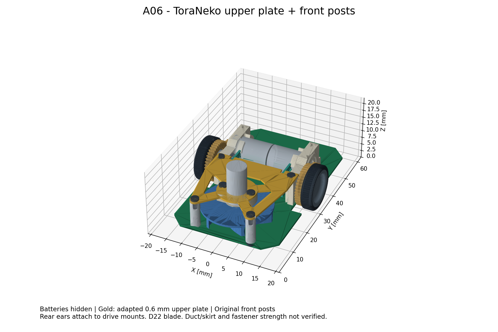

# A06：ToraNekoの構造を使ったファン固定



[3Dビューア](../mechanical/assembly-a06.html) / [組立STEP](../mechanical/assembly-a06.step) / [GLB](../mechanical/assembly-a06.glb) / [上部固定基板STEP](../mechanical/upper-plate-a06.step) / [メイン基板STEP](../mechanical/pcb-a06-concept.step)

A05の樹脂製門型支持具から、ToraNekoの**薄い上部固定基板＋前側支柱2本＋後側の駆動モータマウント**という構成へ作り直した。
ファンの元マウントは上部固定基板の下面に接し、上から2本のネジで固定する。
荷重は上部固定基板から前側支柱と後側駆動マウントへ分散する。元設計と同じ支持方式であり、薄板の剛性が本機でも十分かは実機確認が必要。

## 元設計を確認した根拠

参照CAD `TORANEKO.Mk3_v36.step` には、前案で使っていなかった `支柱 v3` 2個と `上部固定基板 v23` がある。
支柱上面・駆動マウントの支持面・ファンマウント上面と、上部固定基板の下面は、元座標のZ=9.1で一致する。
上部固定基板の6穴が、支柱2点、駆動マウント2点、ファンマウント2点に対応する。

公開リポジトリの資料でも確認した（文書確認コミット `ddcbbb87f2788de40550d7ede1edf355143be338`）。

- [上部固定基板の仕様](https://github.com/Tokoro0917/ToraNeko.Mk3/blob/ddcbbb87f2788de40550d7ede1edf355143be338/hardware/kicad/TORANEKO.Mk3/panel/README.md)：厚さ0.6、銅箔なし、モータ穴Φ6.1、取付穴Φ1.4×6。
- [電池ホルダーの取付説明](https://github.com/Tokoro0917/ToraNeko.Mk3/blob/ddcbbb87f2788de40550d7ede1edf355143be338/mechanical/battery_holder/README.md)：ファンマウントのネジ2本で上部固定基板と共締めし、M1.4ネジを使う記載。
- [スカートの説明](https://github.com/Tokoro0917/ToraNeko.Mk3/blob/ddcbbb87f2788de40550d7ede1edf355143be338/mechanical/skirt_slider/README.md)：メイン基板のΦ8吸入口と前側支柱の固定ネジについて記載。

前案ではCAD穴径だけからネジ規格を未確定としていたが、文書上はM1.4の使用が確認できた。CADの円筒穴自体がねじ山を表すわけではない。
長さ・頭寸法・材質・締付トルク・ねじ掛かりの強度は、調達する実部品に合わせて確定する。

## 今回変えたところ

| 部位 | A06 |
|---|---|
| 車軸・電池・ファン | A04の位置を維持。車軸Y=33、電池中心Y=33、ファン軸Y=16.5 |
| 前側支柱 | 元STEPの形状をそのまま移動。外径3、長さ8.5。X=±8.9、Y=7 |
| 上部固定基板 | 元形状・厚さ0.6・軽量化の抜きを使用。下面Z=10.88693 |
| 上部固定基板の後側取付部 | 旧穴X=±11.9、Y=24を埋め、現在の駆動マウントに合うX=±11.6、Y=29.25へ穴を移設。取付耳を延長 |
| 後側の板幅 | エンコーダ基板との接触を避け、Y=22以降の左右端をX=±13.2以内に調整 |
| エンコーダ逃げ | X=±8.357を中心に幅1.2、Y=29.7以降へ切欠き。基板端から名目0.3 mmのXY隙間 |
| メイン基板 | 前側支柱の通し穴Φ1.6を2個追加。ファン軸直下にΦ8吸入口を追加 |
| ネジ形状 | M1.4×3相当を8本仮置き：上部固定基板の6本＋前側支柱の下面2本 |

A05の左右支柱・橋渡し板・専用穴は使わず、A04から作り直している。
ネジ頭の仮寸法はΦ2.5、高さ0.6。ねじ山・工具溝は省略した占有形状。
上側は板厚0.6に対して約2.4 mm、下面側もメイン基板厚0.6に対して約2.4 mmのねじ掛かりとなる想定。
通し穴Φ1.4とM1.4ネジの名目径が同じため、公差を含む挿入性は未確認。実物・加工条件によって穴径を調整する。
モータ逃げ穴も元設計のΦ6.1を保持しており、Φ6モータに対する片側余裕は約0.05 mmしかない。試作時の確認項目とする。

## 組立の順序

1. メイン基板に前側支柱2本と左右駆動部を取り付ける。
2. ファンモータ・羽根・元マウントの組立を上部固定基板の下面側へ配置し、モータを中央穴に通す。
3. 上部固定基板の上からファンマウントの2本を固定する。
4. 上部固定基板を前側支柱と左右駆動マウントへ載せ、4本で固定する。
5. 羽根の回転、板の反り、ねじ先端、配線の逃げを確認する。

電池ホルダーはまだ追加していない。中央配置の電池は元ToraNekoとは位置が異なるため、公開ホルダーをそのまま置いて成立すると扱わない。
電池底Z=13.5を維持し、上部固定基板上面Z=11.48693とは約2.013 mm空いている。これを今後の電池支持・絶縁に使う。

## 検査と残る設計

[生成スクリプト](../mechanical/build_fan_mount_a06.py) / [検査JSON](../mechanical/fan-mount-a06-checks.json)

今回の生成では77部品・107ソリッドを出力。STEP読み戻しで有効な形状を確認した。781組の交差検査で、意図したねじ掛かり8組以外の食い込みは検出しなかった。Φ22羽根の回転領域と前側支柱の最小隙間は約0.518 mm。外接寸法は幅38.8 × 長さ56.0 × 高さ約19.887 mm。上部固定基板単体は上記密度仮定で約0.497 g（支柱・ネジを含まない）。

新しい上部固定基板・支柱・ネジと既存部品、および追加部品同士の交差を検査する。ねじが下穴へ入る部分だけを意図した重なりとして記録する。
羽根のΦ22回転領域を円柱で囲み、新しい固定部品との干渉を確認する。STEPを再読込して形状の有効性・ソリッド数・目標外形内を確認する。
A04で省略した軸受保持器4個は今回も省略。元部品同士の嵌合、製造公差、板のたわみ、ねじ強度、振動、実走は検証していない。

実形状のあるΦ22羽根を前提とする。文書にあるΦ30羽根へは置換していない。
吸入口を追加したが、ケース・流路・スカートがないため、まだ吸引性能の成立を示すモデルではない。
上部固定基板の質量はFR-4密度1.85 g/cm³を仮定した計算値をJSONに記録する。支柱の材質・実測質量は未確定で、完成機重心や23 g達成は未評価。

## 再生成と出典

```sh
XDG_CACHE_HOME=/tmp/mouse-cad-cache MPLCONFIGDIR=/tmp/mouse-matplotlib /workspace/.tools/mouse-view/bin/python mechanical/build_fan_mount_a06.py
```

参照STEPは`/workspace/library-files/TORANEKO.Mk3_v36.step`。A04組立STEP・構成JSONも入力する。
STEPのSHA-256は `e37a94ba0502e935bd09b7f2973f216830a515db4f88e3210957fa27de5b49ad`。今回取得した公開版とも一致した。
部品形状はCopyright (c) 2026 Tokoro0917、MIT License。
[ライセンス全文](../mechanical/third_party/ToraNeko.Mk3.LICENSE)を派生データと一緒に配布する。
