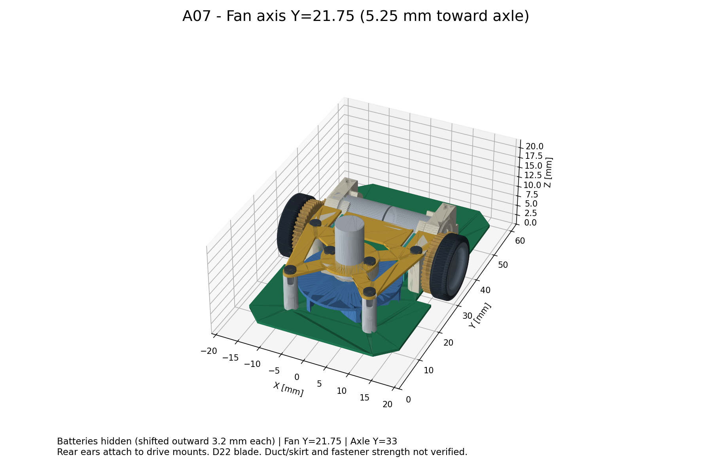

# A07：ファン中心を車軸側へ5.25 mm移動



[3Dビューア](../mechanical/assembly-a07.html) / [組立STEP](../mechanical/assembly-a07.step) / [GLB](../mechanical/assembly-a07.glb) / [上部固定基板STEP](../mechanical/upper-plate-a07.step) / [メイン基板STEP](../mechanical/pcb-a07-concept.step)

ユーザーの「ファンの中心を中心軸に寄せる」を、ファン軸を車軸Y=33へ近づける変更として反映した。左右中心X=0は維持する。
ToraNeko方式の上部固定基板・前側支柱・駆動マウントによる固定構造を継続する。

| 項目 | A06 | A07 |
|---|---:|---:|
| ファン軸Y | 16.5 | **21.75** |
| 車軸からファン軸まで | 16.5 | **11.25** |
| 前側支柱Y | 7 | 12.25 |
| 電池の左右中心X | ±6.3 | **±9.5** |
| 電池の前後中心Y | 33 | 33（維持） |
| 電池の底Z | 13.5 | 13.5（維持） |
| 電池間の隙間 | 0.6 | 7.0 |
| 後側固定穴 | X=±11.6、Y=29.25 | 同じ |

## この配置にした理由

ファンだけを後ろへ移すと、上へ伸びるΦ6モータが電池に入る。
電池2本を左右へ各3.2 mm動かして中央に7 mmの隙間を作り、モータの左右へ名目0.5 mmずつの余裕を確保した。
電池対の前後・上下・左右の重心は、同質量で対称という仮定では変わらない。一方、電池が左右に離れるためヨー方向の慣性は増える。重心位置の改善と慣性の改善は区別する。
実測質量・配線・ホルダーの形状は未確定。中央の隙間をモータ配線に使う余裕は実物で確認する。

Y=21.75ではファンと車軸の前後間隔が元ToraNekoと同じ11.25 mmになり、上部固定基板を前後に延長する必要がなくなる。
元形状の後側取付穴を、駆動部を内側へ寄せた分だけ左右0.3 mm補正する。エンコーダ基板上端に対する名目0.3 mmのXY逃げは残す。
これは元構造を活かした実用候補であり、ファンを限界まで中央へ寄せた最適解と主張するものではない。
車軸直上へ置くには羽根・駆動部・電池の配置をさらに変更する必要がある。

メイン基板の支柱穴とΦ8吸入口も移動した。A06の旧穴は残していない。
モータ・羽根・マウントの相対配置、車軸、ギアの噛合いは変更しない。

## 重心の条件付き比較

以前と同じ「左右駆動部・電池2本・吸引部の5群を各5 g」とする限定モデルでは、吸引部だけがY方向に5.25 mm動く。
よって重心の変化は `5 × 5.25 / 25 = +1.05 mm`。
以前のY=31.2864から**Y=32.3364**となり、車軸より前側の距離は約1.714から**約0.664 mm**へ減る。
電池の左右移動は左右対称なので、この仮定のX重心とY重心を変えない。高さも同じ。
固定基板・支柱・ネジ・実装基板・配線等を含まないため、完成機の重心計算ではない。旧A04重心ファイルは旧配置の記録として保存する。

## 確認範囲

[生成スクリプト](../mechanical/build_fan_mount_a07.py) / [検査JSON](../mechanical/fan-mount-a07-checks.json)

77部品・107ソリッドを出力し、STEP読み戻しで形状の有効性と外形を確認した。外接寸法は幅38.8 × 長さ56.0 × 高さ約19.887 mm。
1093組の交差検査と74組の羽根回転領域検査が完了し、意図したねじ掛かり以外の食い込みは検出されなかった。
羽根回転領域から前側支柱まで約0.518 mm、エンコーダ基板まで約0.532 mm、下のメイン基板まで約0.431 mmの名目隙間。公差・たわみを加えた保証値ではない。

追加固定部品と既存部品の交差に加え、移動したファン3形状と電池2個を既存部品へ照合する。
さらにΦ22羽根を囲む回転領域円柱を、駆動部・電池・メイン基板・支持具へ照合する。
ねじの下穴への掛かりは意図した交差として分ける。元ファン内部の嵌合・元駆動部内部は変更しない。
A04から省略している不正な軸受保持器4個は今回も検査モデルに含まない。

Φ22羽根を前提にした配置検討用モデル。Φ30への適用、製造公差、変形・振れ、強度、実走性能は未検証。
電池ホルダー、吸引ケース・流路・スカート、配線、センサ支持部も未完成。
ネジ仕様・公差とToraNekoの根拠資料は[A06](fan-mount-a06.md)を参照する。

```sh
XDG_CACHE_HOME=/tmp/mouse-cad-cache MPLCONFIGDIR=/tmp/mouse-matplotlib /workspace/.tools/mouse-view/bin/python mechanical/build_fan_mount_a07.py
```

参照CAD：ToraNeko.Mk3、Copyright (c) 2026 Tokoro0917、MIT License。
[ライセンス全文](../mechanical/third_party/ToraNeko.Mk3.LICENSE)を派生出力とともに配布する。
