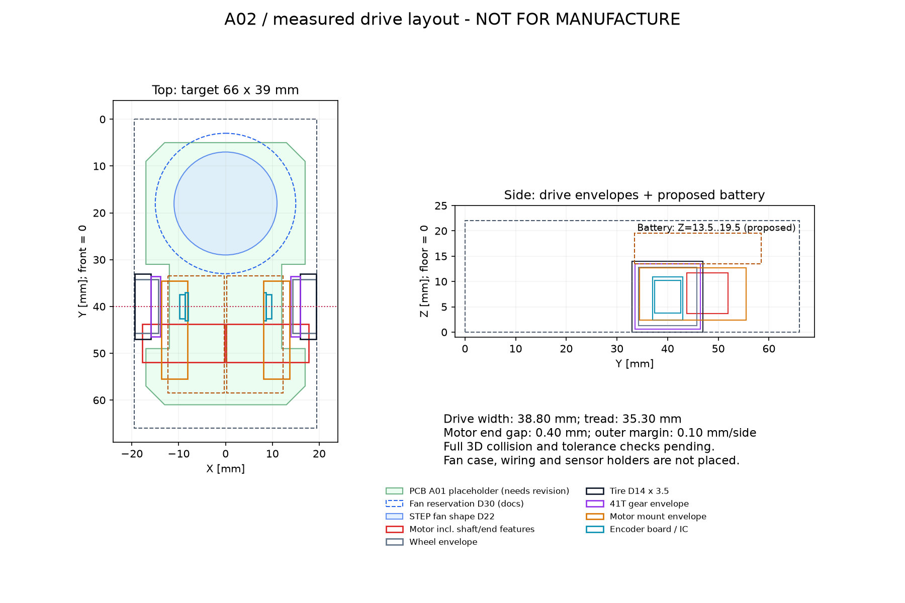

# 配置検討 A02：STEP駆動部の測定



## 結果

**A01のトレッド32 mmは、トラ猫の左右駆動部を同じ前後位置のまま寄せる方法では成立しない。**
STEP上のトレッドは35.9 mm、左右モータの外接箱間隔は1.0 mm。
32 mmへ寄せると左右それぞれ1.95 mmの移動が必要となり、モータの外接箱が左右方向に2.9 mm重なる。
両モータのY・Z範囲も一致するため、この配置を採用しない。

A02は部品を変更せず、元の左右駆動ユニットをそれぞれ0.3 mmだけ内側へ平行移動する検討案。
車軸の前後位置はA01のY=40 mmを維持する。

| 項目 | 元STEP | A02 |
|---|---:|---:|
| 駆動部の全幅 | 39.4 mm | 38.8 mm |
| タイヤ中心間距離 | 35.9 mm | 35.3 mm |
| タイヤ幅（1本） | 3.5 mm | 3.5 mm |
| タイヤ外径 | 14 mm | 14 mm |
| モータ外接箱間隔 | 1.0 mm | 0.4 mm |
| 目標全幅39 mmに対する片側余裕 | -0.2 mm | 0.1 mm |

**片側0.1 mmは小さく、製造公差・タイヤの振れ・端子・配線を含めて成立するとまだ言えない。**
同じ駆動部を同じ前後位置で寄せる場合、理論上の幅下限は38.4 mm（モータ間隔ゼロ）となる。
これより大きな余裕が必要なら、まずモータを前後にずらす等の配置変更や専用マウントを検討する。
購入部品を変更することや目標寸法を広げることは、この案では決定していない。

## 測定方法と証拠

- 入力：トラ猫コミット `724d4f428ec6e257e55830514f37e31215f05e83` の `mechanical/exported/TORANEKO.Mk3_v36.step`
- SHA-256：`e37a94ba0502e935bd09b7f2973f216830a515db4f88e3210957fa27de5b49ad`
- CadQuery 2.8.0 / Open CASCADE経由で部品階層の配置変換を累積し、世界座標の軸平行外接箱を取得。
- [測定プログラム](../mechanical/measure_step.py)、[全81部品インスタンスの測定値](../mechanical/toraneko-v36-bounds.json)、[A02配置後の測定値](../mechanical/layout-a02-measurements.json)。丸める前の値をJSONに保存した。
- 同名の軸受を区別するため、部品名に階層内番号を含める。
- 空形状が1件（`吸引ファンΦ30内径1mm v7`）あり、寸法は測定できない。JSONの`empty_shapes`へ明記した。別のファンSOLIDには形状がある。
- 基板の測定値40 × 64 × 0.6 mmは、先に読んだDXFの40 × 64 mmと一致する。
- モータ、タイヤ、電池、エンコーダ基板は形状を持つ。モータ外接寸法17.6 × 8.1 × 8.1 mmには軸・端部も含むため、カタログの胴体寸法と混同しない。

## 上流資料との不一致

| 項目 | 文書 | STEP測定 | A02での扱い |
|---|---|---|---|
| ファン外径 | Φ30 | 形状のあるファンSOLIDはXYとも22 mm。Φ30という名前の子要素は空形状 | 確定できないため30 mmの予約範囲を維持し、22 mm形状も併記 |
| タイヤ下端（基板下面=0） | スカートスクリプトで-2.36 mm | -1.78693 mm | A02の床は測定したタイヤ下端。旧スクリプトの床座標を混ぜない |
| タイヤ幅 | A01は5 mmを仮定 | 3.5 mm（ホイール全幅は5.1 mm） | 部品別に分ける |

名前に書かれた寸法よりモデル形状を優先して測定したが、モデルと実物が一致するかは別途確認が必要。
ファンの未確定部分を「同じ部品」という指定だけで確定扱いにはしない。

## 高さ・基板について

測定した床をZ=0へ移すと、モータマウント上端は約12.69 mm。
電池底をZ=13.5 mm、上端19.5 mmと仮置きし、マウント上端から約0.81 mm離す。
22 mmの枠まで残り2.5 mmだが、電池ホルダー・配線・コネクタは未設計である。
左右の電池は平面図上でタイヤ・ギアの内側にあり、側面図だけの重なりでは接触を意味しない。

基板の緑輪郭はA01の仮形状を残したもの。**A02のモータマウント・エンコーダ接続・ギア逃げに合わせた輪郭ではない。**
特に車輪付近の切欠きと支持面は修正が必要。穴やEdge.Cutsを確定する前に、3Dの取付・干渉・公差確認を行う。
外接箱の検査は部品同士の正確な接触・嵌合の検証ではない。重量23 gについても未検証。

## 再生成

Python 3.12で確認。参照STEPはこのリポジトリに同梱していない。

```sh
python3 -m venv /workspace/mouse-cad-tools
/workspace/mouse-cad-tools/bin/pip install -r mechanical/requirements-cad.txt
/workspace/mouse-cad-tools/bin/python mechanical/measure_step.py /path/to/TORANEKO.Mk3_v36.step mechanical/toraneko-v36-bounds.json
MPLCONFIGDIR=/tmp/mouse-matplotlib /workspace/mouse-cad-tools/bin/python mechanical/generate_layout_a02.py
```

実際の検証では作業用venv `/tmp/mouse-layout-tools` を使用した。生成器は駆動部幅38.8 mm、モータ外接箱間隔0.4 mmを確認してから図を出力する。
これは当該入力と配置の再現性チェックであり、全機体の成立性を判定するテストではない。

## 次に解決する項目

1. 左右モータ端部0.4 mm、外幅片側0.1 mmの余裕が実物と公差を含めて十分か。必要なら駆動部の前後配置から見直す。
2. Φ22/Φ30ファンの実際の使用部品と、ケース・流路・床との位置関係。
3. 新規のモータマウント・基板切欠き・取付穴・センサ支持部。
4. 最後に配線と電池交換空間を加えた3D干渉確認、重量計算。
