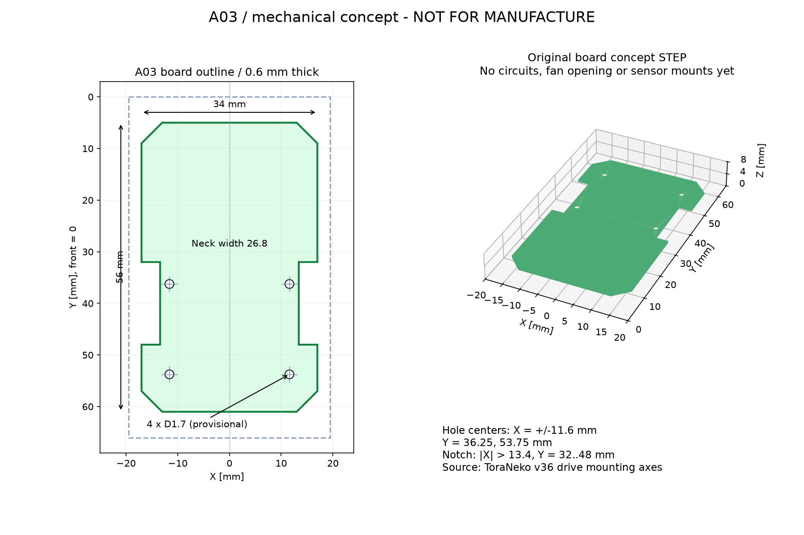

# 配置検討 A03：取付穴付き基板と静的干渉確認



## 今回作成したもの

- [基板候補STEP](../mechanical/pcb-a03-concept.step)：新規に作成した基板外形と取付穴。Fusion等で読み込んで検討するためのモデル。
- [基板候補STL](../mechanical/pcb-a03-concept.stl)：同じ基板候補の形状確認用。
- [上面・3Dプレビュー](../mechanical/pcb-a03-preview.png)
- [検査結果JSON](../mechanical/layout-a03-checks.json)：入力STEPのハッシュ、配置、検査対象、共通体積、距離を保存。

**製造用確定データではない。** 銅箔・回路・ファン吸入口・センサ取付部・板端の加工Rは未設計。試作発注や基板製造には使わない。
元のトラ猫STEP形状そのものは出力モデルへ含めず、検査時のみ外部ファイルから読み込む。

## A02からの変更

駆動部の配置（各側0.3 mm内寄せ、車軸Y=40、トレッド35.3 mm）は維持。
基板の切欠きをX=±13.4、Y=32〜48 mmへ変更し、マウント取付穴を加えた。

| 項目 | A03の値 | 根拠 |
|---|---:|---|
| 基板最大幅・長さ | 34 × 56 mm | 新規の仮設計。機体の目標39 × 66 mmとは異なる |
| 厚さ | 0.6 mm | 元の基板厚を継承。剛性・製造仕様は未確認 |
| 基板の前後端 | Y=5〜61 mm | 機体前端をY=0とする |
| 車輪部のくびれ幅 | 26.8 mm | ギア逃げとマウント支持の両立を検討 |
| 基板下面の床からの高さ | 1.78693 mm | STEPタイヤ下端を床Z=0へ移した座標 |
| マウント穴中心X | ±11.6 mm | 元STEPマウント底側の円筒穴軸を測定し、内寄せ分を反映 |
| マウント穴中心Y | 36.25 / 53.75 mm | 元STEPマウント底側の穴軸、前後間隔17.5 mm |
| マウント穴径 | 1.7 mm ×4 | M1.4用の仮通し穴。実ネジ・加工仕様は未確認 |
| 前側穴の縁から切欠きまで | 0.95 mm | 13.4−11.6−1.7/2。強度を保証する値ではない |

穴軸の抽出では、マウント内のZ方向の円筒面を調べた。元のX=-25.3/-1.5、Y=-9.0721/8.4279 mmの底側穴を採用。
他の高さの穴やモータ・軸受の円筒面は取付穴に混同していない。

## 検査結果と範囲

元STEPの左右駆動部64インスタンスを新配置へ平行移動し、次を検査した。

| 対象 | 検査数・結果 |
|---|---|
| 基板と駆動部 | 64組、静的な食い込みなし |
| 電池の直方体2個と駆動部 | 128組、静的な食い込みなし |
| 左右駆動ユニット間 | 最短距離0.4 mm |
| 基板と左右41Tギア | 各0.5 mmの静的最短距離 |
| トレッド32 mmの旧案 | モータ形状の共通体積約149.44 mm³。実際に重なるため不採用 |
| 基板候補 | 有効な単一ソリッドとして生成 |

検査は外接箱による候補抽出とOpen CASCADEによる共通体積計算を使用する。
食い込みの数値判定は共通体積が1e-5 mm³より大きい場合。面接触や丸め誤差は食い込みと区別する。
距離が1.01 mmより遠い外接箱については、厳密な形状間距離を計算せず距離の下限を記録する。
JSONの`distance_mm: null`は距離ゼロを意味しない。`bbox_distance_lower_bound_mm`と併せて読む。
距離計算値が外接箱の下限と矛盾した場合は`distance_inconsistent`を立て、厳密値として採用しない。

元STEPの非ミラー側にある軸受保持器`LF-630_cage`の2形状は、Open CASCADEの有効性検査に通らなかった。
初回の厳密距離計算でも外接箱と矛盾するゼロ距離が出たため、その数値は採用していない。
今回の基板・電池との比較では、この2形状は外接箱でも少なくとも約1.96 mm離れており、食い込みなしの判断は外接箱の分離による。
これらの保持器の形状そのものや軸受内部の嵌合が正しいと検証したわけではない。元データは変更していない。
最終結果では距離下限に矛盾する値は採用されておらず、電池と駆動部の外接箱距離の下限は最小約0.815 mm。

モータマウント底側の0.05 mm薄片で支持面を調べると、断面積約60.55 mm²のうち基板と重なる投影は約57.98 mm²（約95.8%）。
この計算には基板側の通し穴による面積減少も含む。接触圧・曲げ剛性・締結強度の解析ではない。

## まだ確定できない項目

- 外幅余裕は引き続き片側0.1 mm。タイヤの振れや製造・組立公差が未指定で、量産や実走に十分とは判断できない。
- モータ間0.4 mmには配線・端子の実形状や配線作業空間を追加する必要がある。
- 電池は外形12×25×6 mmの直方体。保護部・リード・コネクタ・固定具は含めていない。
- 歯車の全回転範囲、ネジ頭、センサホルダー、吸引ケース・流路は未検証。
- ファン径は文書Φ30とSTEP形状Φ22に不一致があり、ケースの形状を確定しない。
- 23 gの重量目標、基板の剛性、接地・吸引・走行性能は未検証。
- 同じ側の駆動部品同士の嵌合は元STEPのままで、今回の192組の検査には含まない。

このため、今回の結果は「指定した静的モデルで基板候補が駆動部へ食い込まない」という範囲に限る。

## 再生成

[A02の手順](layout-a02.md#再生成)でCAD用Python環境を用意し、リポジトリのルートで実行する。

```sh
XDG_CACHE_HOME=/tmp/mouse-cad-cache /workspace/mouse-cad-tools/bin/python mechanical/check_layout_a03.py /path/to/TORANEKO.Mk3_v36.step
XDG_CACHE_HOME=/tmp/mouse-cad-cache MPLCONFIGDIR=/tmp/mouse-matplotlib /workspace/mouse-cad-tools/bin/python mechanical/draw_pcb_a03.py
```

実行時は作業用の `/tmp/mouse-layout-tools` を使用した。STEPのハッシュが異なる場合は停止する。
変更後は検査結果JSONの食い込み・不正形状・距離計算の矛盾を読み、スクリプト終了だけを合格と見なさない。
