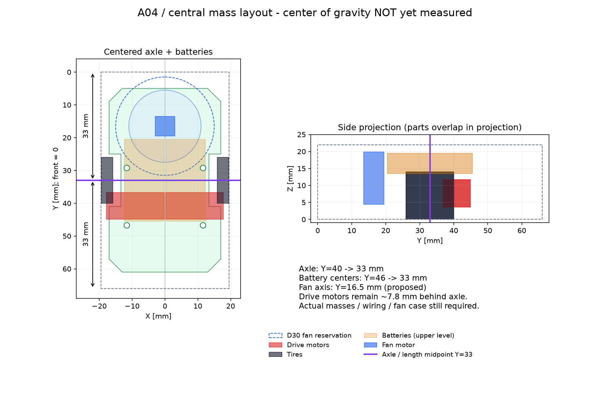

# 配置検討 A04：車軸と重い部品を中央へ



## ユーザー指定の反映

「中心軸にタイヤを置く」「重い物を中心寄りにする」を、左右タイヤの共通車軸を機体の前後中央へ置く方針として反映した。
全長66 mmの前端をY=0とし、車軸はY=33 mm。左右はX=0を中心に対称配置する。
電池2本も前後中心をY=33 mmへ移し、左右対称に並べる。

| 項目 | A03 | A04 |
|---|---:|---:|
| 車軸のY位置 | 40 mm | **33 mm** |
| 前端・後端から車軸まで | 40 / 26 mm | **33 / 33 mm** |
| 電池のY中心 | 46 mm | **33 mm** |
| 電池前後範囲 | 33.5〜58.5 mm | **20.5〜45.5 mm** |
| 電池の左右中心 | ±6.3 mm | ±6.3 mm（維持） |
| 電池底・上端高さ | 13.5 / 19.5 mm | 同じ。上げずに維持 |
| 車輪切欠きのY範囲 | 32〜48 mm | **25〜41 mm** |
| マウント穴のY位置 | 36.25 / 53.75 mm | **29.25 / 46.75 mm** |
| マウント穴のX位置 | ±11.6 mm | 同じ |

左右駆動部をまとめて前へ7 mm移動するため、ギアの噛合い・磁石とエンコーダの相対配置は変えない。
全幅38.8 mm・トレッド35.3 mmは維持。全幅39 mmに対して片側0.1 mmしかない問題は残る。

## 中央に寄せる範囲と限界

電池は比較的重い部品なので、まず車軸の真上へ寄せた。ただし質量は未測定であり、他部品との重量比較を実測したわけではない。
2本が同じ質量・対称な質量分布なら、電池対の重心はX=0、Y=33となる。リードやコネクタを含めるとずれる可能性がある。

モータは同じギア・マウントを維持すると車軸より約7.8 mm後ろにある。この距離を単にゼロにするとギア配置が崩れるため、今回は保持する。
吸引ファン軸はY=16.5 mmに仮配置し、電池前端20.5 mmへ近づける。
ファンモータ胴体の後端はY=19.5 mmで、電池前端との前後方向の余裕は1 mm。
ファンモータ端子・配線・ケースをまだ含めないため、これ以上近づけない。

ファン径は資料上Φ30、形状を持つSTEPの羽根はΦ22という不一致が残る。
Φ30の円柱予約領域もチェックするが、実際のケースや流路、支持部の代わりにはならない。
ファン・マウントは仮の空間配置で、基板へ固定する支持構造は未完成。

## 重心についての判断

**車軸を中央に置いたことと、完成機の重心が車軸上にあることは別。**
今回確定するのは配置方針であり、重心位置・前後バランス・慣性モーメントの改善量はまだ算出しない。
STEPの幾何形状の中心や、部品の外接箱中心を実物の重心として使わない。

各部品の質量mと実際の重心座標yが分かれば、車軸周りの前後の質量モーメントは
`Σ m × (y − 33)`、完成機の重心位置は `Σ(m × y) / Σm` で確認できる。
前後モーメントが残る場合、電池対の質量をMとすると、電池の調整距離は `−残りのモーメント / M` が目安になる。
実際に動かすときはファン・モータ・配線との干渉を再確認する。

低重心化も必要なので、電池の高さはA03から上げない。さらに下げられるかは、ホルダー・マウント・絶縁・配線を設計した後に検討する。
現物の電池2本、左右駆動部、吸引部、実装基板、固定具・配線を秤で測り、完成状態でもバランスを確認する。

[質量・重心入力表](../mechanical/mass-input.csv)を用意した。空欄は未測定であり、ゼロを意味しない。
座標は床Z=0、機体前端Y=0、左右中心X=0。グループの重心座標を記入し、外接箱中心で代用した値は測定値と区別する。

## ファイルと検証方法

- [基板候補STEP](../mechanical/pcb-a04-concept.step) / [STL](../mechanical/pcb-a04-concept.stl)：車輪切欠き・取付穴を中央配置に変更した新規基板モデル
- [検査・配置データ](../mechanical/layout-a04-checks.json)：部品配置の外接箱、共通体積、距離下限など
- [検査スクリプト](../mechanical/check_layout_a04.py)
- [配置図生成](../mechanical/draw_layout_a04.py)

元STEPのハッシュ、距離検査の意味、不正な軸受保持器2形状の扱いは[A03](layout-a03.md)と同じ。
静的検査は、新規基板と64駆動部品、電池2個と駆動部、吸引部3形状と基板・電池・駆動部、Φ30予約領域と基板・電池・駆動部を対象とする。
この460組の検査で食い込み・採用距離値の矛盾は検出されなかった。Phi30予約領域と駆動マウントの静的最短距離は約0.553 mm、エンコーダ基板とは約0.721 mm。
不正な保持器2形状はBoolean結果を判断根拠とせず、外接箱の分離、またはΦ30円柱と外接箱の半径方向の分離を追加確認した。
該当14組は保守的な距離下限がすべて正で、最小約1.962 mm。検査JSONの`invalid_shape_separation_evidence`に記録した。
吸引部同士の嵌合、回転全域、コネクタ、センサ、ネジ、公差、剛性、重量23 gの成立性は未検証。
基板にはまだ吸入口や吸引部・センサ支持部がなく、製造用確定データではない。

```sh
XDG_CACHE_HOME=/tmp/mouse-cad-cache /workspace/mouse-cad-tools/bin/python mechanical/check_layout_a04.py /path/to/TORANEKO.Mk3_v36.step
MPLCONFIGDIR=/tmp/mouse-matplotlib /workspace/mouse-cad-tools/bin/python mechanical/draw_layout_a04.py
```

検証時は `/tmp/mouse-layout-tools` のPythonを使用。
