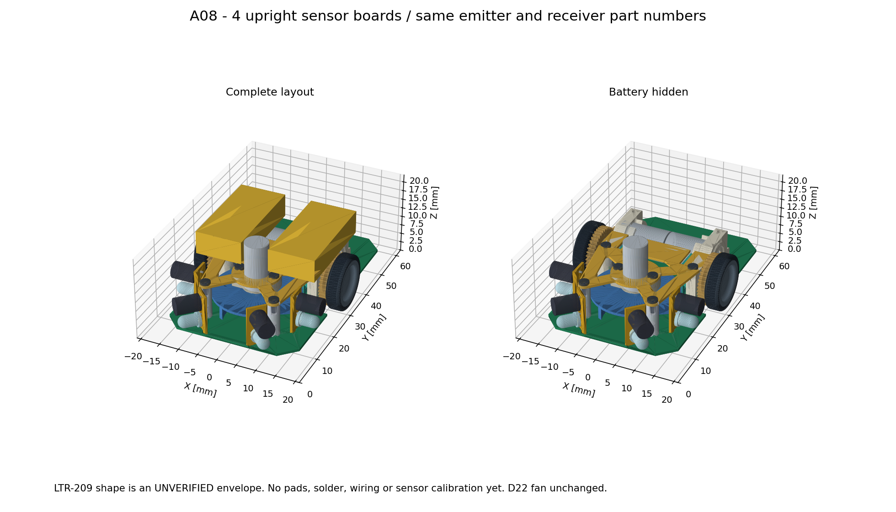

# A08：同じセンサ部品を立て基板へ載せる



[3Dビューア](../mechanical/assembly-a08.html) / [組立STEP](../mechanical/assembly-a08.step) / [GLB](../mechanical/assembly-a08.glb) / [メイン基板STEP](../mechanical/pcb-a08-concept.step) / [立て基板単体STEP](../mechanical/sensor-board-a08.step)

写真のようにセンサ用の小基板をメイン基板へ垂直に立てる候補を追加した。
ユーザー指定に従ってToraNekoと同じ発光OSI5FU3A11C・受光LTR-209を使用する方針。
小型SMD部品へ変更したモデルではない。元BOMと同じ各4個、4組構成を維持する。
写真の正確な部品型番・枚数を推定して複製したものではない。

## 配置と形

横並びの発光・受光では前側支柱に当たるため、**1枚の立て基板に上下2段**で載せる。
部品のリードを小基板に水平に通してはんだ付けし、光軸を壁へ向ける。
発光の光軸高さは床から5.4、受光は10.1 mm。光軸は水平の仮配置であり、近距離で両者の照射・受光範囲が重なるか、実物で確認する。
立て基板4枚は同じ形状を用い、メイン基板上の取り付け角度で方向を変える。

| チャンネル | 小基板中心X,Y [mm] | 正面からの向き |
|---|---|---|
| 左前斜め | −7, 7 | 左45° |
| 右前斜め | +7, 7 | 右45° |
| 左側方 | −12.6, 16.5 | 左90° |
| 右側方 | +12.6, 16.5 | 右90° |

- 小基板：幅5 × 高さ10.2 × 厚さ0.6 mm。高さはメイン基板上面から。
- 下端の差込タブ：幅1.2 × 厚さ0.6 × 深さ0.6、2個。中心間隔2.6 mm。
- メイン基板の差込穴：全長1.8 × 幅1.0の長穴、端R0.5、各基板2個。
- 小基板のリード穴：仮Φ0.8、ピッチ2.54。発光・受光それぞれ2穴。
- 部品根元と小基板の間は0.5 mmの仮隙間。リード後端は小基板の裏へ0.7 mm出る形状。

長穴とタブには遊びがあるため、差すだけでは角度も垂直度も固定できない。
**組立治具で位置・垂直度を保持し、根元のランドをメイン基板へはんだ付けする方式**を想定する。
さらに機械的補強が必要なら根元へ少量の接着剤を追加する。現モデルは裸基板と部品・リードのみで、銅箔・ランド・はんだフィレット・接着剤は未設計。
単に裸のFR-4同士へはんだを付けるという意味ではない。取付ランドの接続、必要な信号・電源・GNDの配線は回路設計で決める。
はんだ・接着剤の占有空間、銅箔クリアランス、工具の入り方を追加してから製造図面を確定する。

## 部品寸法の根拠と未確認部分

ToraNekoの`hardware/kicad/TORANEKO.Mk3/BOM.csv`は、OSI5FU3A11C×4、LTR-209×4、前斜め2組＋側方2組と記載している。
発光は公開リポジトリ同梱の`hardware/datasheets/OSI5FU3A11C.pdf`（VER A.0）を確認した。

| 対象 | モデルの扱い |
|---|---|
| OSI5FU3A11C | 本体Φ3、つばΦ3.9×0.75、全長5.35、ピッチ2.54の簡略形状。つばの平面カットやリード付け根の拡幅は省略 |
| LTR-209 | **外形図未確認**。Φ4.2×長さ6の円柱予約領域、リードピッチ2.54を仮定。確認済み製品形状として扱わない |
| リード | Φ0.5の円柱で簡略表示。実際の断面・はんだ形状を再現しない |

元リポジトリではLTR-209のデータシートが未アップロード。今回のメーカーサイトへの取得要求はHTTP 403で資料を確認できなかった。
元の回路図は受光にも3 mm LED系フットプリントを指定しているが、それだけでは全長・つば径・端子位置を保証しない。
**この予約領域に収まることが、実際のLTR-209が確実に収まることの証明ではない。** 現物または正しい外形図で更新が必要。
発光データシートの一般公差±0.30等をすべて加算した最大外形ではないため、公差検証も残る。
側方へ出る部品が幅39 mmの制約に近いので、特に全長・基板からの浮き・はんだ付け後の傾きを確認する。

## ファンと機体サイズ

A07のファン軸Y=21.75、Φ22羽根、支柱・上部固定基板、車軸Y=33、電池配置を引き継ぐ。
現時点ではファンを縮小していない。まず同じセンサ部品を立て基板へ移す構成で空間を確認する。
受光部品の実寸、公差、はんだ・配線、センサの遮光部品を入れて収まらない場合は、ユーザーの許可に従って吸引系の小型化を再検討する。
羽根だけの一律縮小を実物の設計変更として扱わず、ケース・モータ・流量・吸引性能との整合も確認する。

## 検証の範囲

[生成・検査スクリプト](../mechanical/build_sensor_a08.py) / [検査JSON](../mechanical/sensor-a08-checks.json)

- 新しい立て基板・センサ形状・リードとA07の全部品、および新部品同士の静的交差。
- 全8長穴の領域がメイン基板内にあり、タブが差し込めること。
- Φ22羽根の回転領域円柱と新部品の交差。
- 部品の予約領域の先から前方20 mmの細い円柱に、別部品が入らないこと。これは中心線の遮蔽確認であり、照射角・受光角全体、壁面反射、測距性能の検証ではない。
- STEPの読み戻し、形状の有効性、ソリッド数、目標66×39×22内への収まり。

今回の出力は97部品・135ソリッド。1730組の静的交差、20組の羽根回転領域、8本の光軸中心線を確認し、食い込み・遮蔽は検出しなかった。STEP再読込も有効。
予約形状を含む外接寸法は**幅38.8 × 長さ約60.293 × 高さ約19.887 mm**で、目標39×66×22内に収まる。受光部の寸法仮定と未反映の公差を前提とした結果。

既存の4個の軸受保持器はA07と同じく表示省略。既存部品同士の嵌合は今回の検査を追加していない。
光学調整では上下の光軸間隔4.7 mmが近距離の受光量に与える影響、床面反射、隣の発光部からの回り込みを測る。
必要に応じて受光部の傾き・遮光壁・光軸高さを調整する。元ToraNekoのセンサ校正値をそのまま使わない。
小基板の強度・振動、回路・配線、銅箔・ランド、電池支持、吸引ケース・流路・スカートは未完成。
**機構検討用であり、製造用確定データではない。**

## 再生成・出典

```sh
XDG_CACHE_HOME=/tmp/mouse-cad-cache MPLCONFIGDIR=/tmp/mouse-matplotlib /workspace/.tools/mouse-view/bin/python mechanical/build_sensor_a08.py
```

A07組立STEPを入力。`sensor-board-a08.step`は左前斜め基板を組立位置の座標で出力しており、他3枚も同じ形状。
参照部品はToraNeko.Mk3、Copyright (c) 2026 Tokoro0917、MIT License。
[ライセンス全文](../mechanical/third_party/ToraNeko.Mk3.LICENSE)を派生出力とともに配布する。
